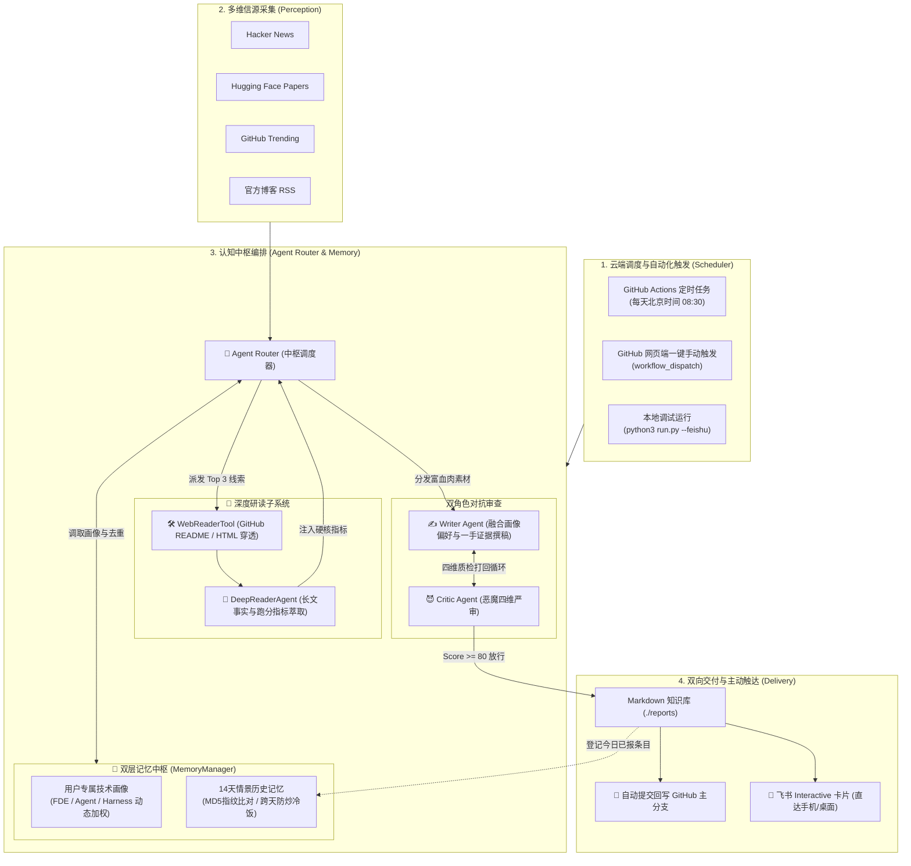

# 🪐 AI Daily Knowledge Agent (AI 每日情报知识管家)

> 每日全自动追踪全球 AI 前沿动态，经过个性化记忆中枢加权、自主深度翻阅网页/README长文、多智能体路由协同与恶魔质检对抗打磨，沉淀为高质量结构化知识库，并支持 GitHub Actions 7×24 云端全托管与飞书多维交互卡片主动触达。

[](https://github.com/cheeseooh-ctrl/AI-Knowledge-Agent)
[](https://www.python.org/)
[](LICENSE)

---

## 📌 版本演进与更新日志 (Changelog)

| 版本号 | 发布日期 | 架构类型 | 核心变更与新特性 |
| :---: | :---: | :---: | :--- |
| **`v2.0.0`** *(当前)* | 2026-11-16 | **云端全托管与主动触达智能体** | 1. **全自动免开机云端托管**：引入 GitHub Actions 编排，支持每天北京时间 08:30 定时无感执行，或通过网页端一键手动触发。<br>2. **飞书交互式卡片 (Interactive Card) 推送**：打造高颜值专属飞书早报卡片，直达手机与桌面端，包含审稿档案徽章、深度技术穿透细节与直达按钮。<br>3. **零依赖安全推送器**：新增 `FeishuPusher`，支持环境变量 `FEISHU_WEBHOOK_URL` 注入与 `--dry-run-feishu` 离线校验。<br>4. **记忆与早报双向回写**：云端执行后自动将新生成的日报和更新后的 14 天记忆库回写至 GitHub 主分支。<br>5. **设计文档归档**：新增 [`docs/v2.0.0_Cloud_Automation_and_Feishu_Push_Design.md`](docs/v2.0.0_Cloud_Automation_and_Feishu_Push_Design.md)。 |
| **`v1.3.0`** | 2026-11-14 | 个性化记忆驱动智能体 | 1. 引入 `MemoryManager` 记忆中枢，实现双层记忆架构（语义用户画像 + 14 天情景历史记忆）。<br>2. 基于 MD5 语义指纹自动识别最近 14 天已报内容，压制重复霸榜老线索。<br>3. 专属技术画像动态阶梯式提权加分。<br>4. 归档 [`docs/v1.3.0_Personalized_Memory_Agent_Design.md`](docs/v1.3.0_Personalized_Memory_Agent_Design.md)。 |
| **`v1.2.0`** | 2026-11-14 | 深度穿透认知智能体 | 1. 引入 `DeepReaderAgent` 深度穿透研究员与 `WebReaderTool` 专用工具链，自主翻阅 5000+ 字官方正文与 GitHub README。<br>2. 提炼底层架构细节、实测跑分指标、开发者实操价值与作者自承已知局限四大硬核事实。<br>3. 早报新增 `[🔬 深度技术穿透]` 专属角标。 |
| **`v1.1.0`** | 2026-11-14 | 多智能体动态路由架构 | 1. 引入 `AgentRouter` 调度中枢，实现多智能体条件分发与反思回环。<br>2. 新增 `WriterAgent`（初稿与改版）与 `CriticAgent`（四维量化打分，>=80分放行）。<br>3. 新增 `--git-push` 自动同步至 GitHub 远端知识库。 |
| **`v1.0.0`** | 2026-11-14 | 确定性自动化流水线 | 1. 搭建四大信源采集矩阵（HN, HF Papers, GitHub Trending, RSS）。<br>2. 实现 URL 归一化与去重清洗。<br>3. 建立零依赖 Python 原生 REST 通信机制与基础 Markdown 导出。 |

### 🚀 后续演进路线图 (Roadmap)
* [x] **v1.0.0**：零外部依赖的高可用数据采集与清洗流水线。
* [x] **v1.1.0**：Agent Router 驱动的“主笔 + 恶魔质检员”对抗博弈机制与 Git 自动同步。
* [x] **v1.2.0**：引入「深度穿透研究员 (Deep Reader)」—— 自主调用工具翻阅论文全文、官方文档与 GitHub README。
* [x] **v1.3.0**：引入「个性化记忆中枢 (Memory)」—— 基于用户专属技术画像与 14 天情景历史实现防炒冷饭与动态提权。
* [x] **v2.0.0**：接入 GitHub Actions 云端全托管，实现电脑关机状态下的免开机定时推送与飞书多维交互卡片。
* [ ] **v2.1.0**：智能体全链路可观测性 (Live Trace Waterfall) 与 Token 成本审计账单。
* [ ] **v2.2.0**：基于 Streamlit 的轻量交互控制台（在网页端拖拽微调画像与一键生成）。
* [ ] **v2.3.0**：引入内置 SQLite 与本地向量库，打造支持跨天跨月长程语义问答的个人知识助手。

---

## 🏛️ v2.0.0 核心系统架构图 (云端托管与主动触达拓扑)



---

## 📂 工作区完整目录结构清单 (已全面同步至 v2.0.0)

```
AI Knowledge Agent/
├── .github/                        # 🤖 [v2.0.0 新增] 云端全自动调度工作流
│   └── workflows/
│       └── daily_briefing.yml      # 每天早晨 08:30 免开机定时运行与自动同步工作流
├── config.json                     # [v2.0.0] 全局配置 (信源、Router、Memory、飞书推送)
├── .env.example                    # 环境变量配置模板 (GEMINI_API_KEY, FEISHU_WEBHOOK_URL)
├── requirements.txt                # 可选依赖项
├── run.py                          # [v2.0.0] 一键执行入口 (支持 --feishu, --dry-run-feishu, --git-push 等)
├── README.md                       # [v2.0.0] 本项目说明书与版本演进日志
├── data/                           # 💾 本地持久化数据目录
│   └── memory/                     # 记忆持久化库
│       ├── user_profile.json       # 用户专属技术画像配置
│       └── reported_history.json   # 14 天内已报道线索的指纹记忆库
├── docs/                           # 📐 系统设计规范与需求说明书 (PRD & TDD)
│   ├── SYSTEM_DESIGN.md            # 系统完整设计与需求规格说明书 (PRD + 认知架构总纲)
│   ├── v1.1.0_Agent_Router_Design.md   # [v1.1.0] Router 编排架构与时序图设计文档
│   ├── v1.2.0_Deep_Reader_Agent_Design.md # [v1.2.0] 深度穿透研究员与工具链设计文档
│   ├── v1.3.0_Personalized_Memory_Agent_Design.md # [v1.3.0] 个性化双层记忆中枢设计文档
│   └── v2.0.0_Cloud_Automation_and_Feishu_Push_Design.md # [v2.0.0] 云端全托管与飞书推送设计文档
├── learning_notes/                 # 💡 技术学习笔记与知识沉淀专区 (非设计文档)
│   ├── AI_Agent_Architecture_QnA.md    # 智能体底层 12 个核心概念深度问答
│   └── AI_Learning_Interests_and_Capability_Gap_Analysis.md # 用户技术画像、认知盲区诊断与成长路线
├── src/
│   ├── utils.py                    # 零依赖 HTTP 通信与环境读取工具
│   ├── notification/               # 📱 [v2.0.0 新增] 主动通知推送渠道
│   │   ├── __init__.py
│   │   └── feishu_pusher.py        # 飞书交互式多维卡片组装与原生网络推送器
│   ├── tools/                      # 🛠️ 专用工具链 (web_reader.py)
│   ├── memory/                     # 🧠 记忆中枢子系统 (memory_manager.py)
│   ├── collectors/                 # 📡 4 大数据采集器 (HN, HF, GitHub, RSS)
│   ├── processor/                  # 🧠 核心清洗与多智能体集群 (Router, DeepReader, Writer, Critic)
│   └── exporters/                  # 📰 导出与呈现 (markdown_exporter.py)
└── reports/                        # 历史情报日报归档目录
    ├── 2026-11-14_AI_Daily_Briefing.md
    └── 2026-11-14_AI_Daily_Briefing.json
```

---

## 🚀 运行指令说明

* **完整运行深度穿透、记忆画像对齐并主动推送到飞书**：
  ```bash
  python3 run.py --feishu
  ```

* **飞书卡片离线预览模式（Dry-Run，仅打印卡片报文不发网络请求）**：
  ```bash
  python3 run.py --dry-run-feishu
  ```

* **完整运行并自动提交同步到 GitHub**：
  ```bash
  python3 run.py --git-push
  ```

* **清空历史记忆缓存（重新开始 14 天去重比对）**：
  ```bash
  python3 run.py --clear-memory
  ```

* **跳过记忆中枢（以完全无状态模式运行）**：
  ```bash
  python3 run.py --no-memory
  ```

* **极速快讯模式（跳过长文穿透，提速 70%）**：
  ```bash
  python3 run.py --no-deep
  ```

* **本地单机模拟模式（无需 API Key）**：
  ```bash
  python3 run.py --mock --dry-run-feishu
  ```

---

## 📱 飞书机器人配置与 GitHub Actions 云端免开机部署指南

### 第一步：获取飞书自定义机器人 Webhook 地址
1. 打开飞书任意群组（建议建一个只有你自己的“个人情报站”测试群）；
2. 点击群设置 $\to$ **【机器人】** $\to$ **【添加机器人】** $\to$ 选择 **【自定义机器人】**；
3. 为机器人命名为 `AI 情报知识官`，复制生成的 **Webhook 地址**（格式如 `https://open.feishu.cn/open-apis/bot/v2/hook/xxxx`）。

### 第二步：配置 GitHub Actions 云端自动调度 Secrets
1. 打开你的 GitHub 仓库主页：[`cheeseooh-ctrl/AI-Knowledge-Agent`](https://github.com/cheeseooh-ctrl/AI-Knowledge-Agent)；
2. 依次点击顶部标签栏 **Settings** $\to$ 左侧菜单 **Secrets and variables** $\to$ **Actions**；
3. 点击 **New repository secret**，添加以下两个机密密钥：
   * `GEMINI_API_KEY`：你的 Google Gemini API 密钥；
   * `FEISHU_WEBHOOK_URL`：上面第一步复制的飞书 Webhook 完整地址；
4. **大功告成！** 
   * **自动运行**：GitHub Actions 会在每天**北京时间早晨 08:30** 准时免开机唤醒，执行全网深度采集，并将高颜值卡片直接推送到你的手机飞书！
   * **手动测试**：你也可以在仓库的 **Actions** 标签页找到 `Daily AI Knowledge Briefing & Push`，点击 **Run workflow** 随时手动触发一次全链路测试！
