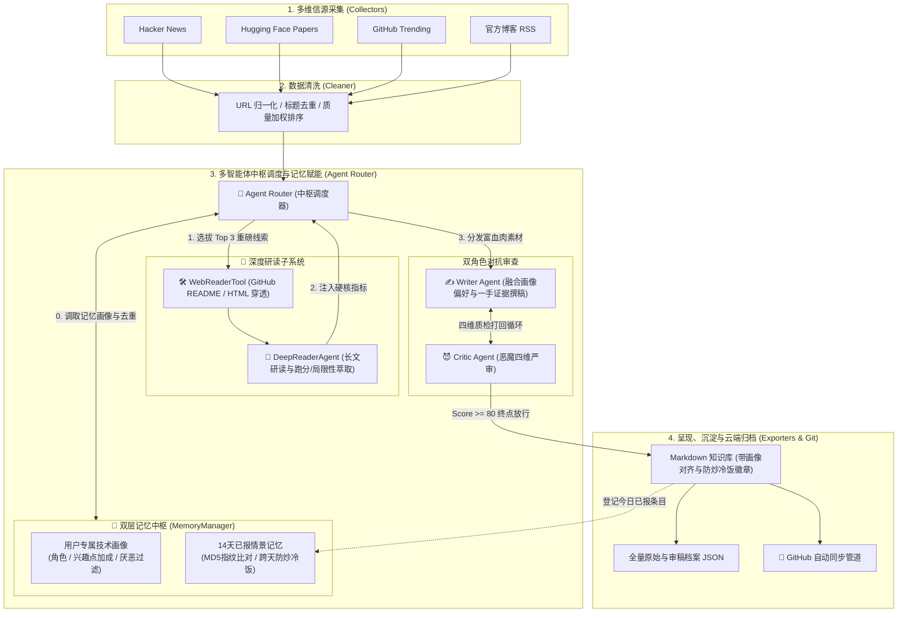

# 🪐 AI Daily Knowledge Agent (AI 每日情报知识管家)

> 每日全自动追踪全球 AI 前沿动态，经过个性化记忆中枢加权、自主深度翻阅网页/README长文、多智能体路由协同与恶魔质检对抗打磨，沉淀为高质量结构化知识库。

[](https://github.com/cheeseooh-ctrl/AI-Knowledge-Agent)
[](https://www.python.org/)
[](LICENSE)

---

## 📌 版本演进与更新日志 (Changelog)

| 版本号 | 发布日期 | 架构类型 | 核心变更与新特性 |
| :---: | :---: | :---: | :--- |
| **`v1.3.0`** *(当前)* | 2026-11-14 | **个性化记忆驱动智能体** | 1. **引入 `MemoryManager` 记忆中枢**：摆脱无状态失忆缺陷，实现双层记忆架构（语义用户画像 + 14 天情景历史记忆）。<br>2. **跨天防炒冷饭机制**：基于 MD5 语义指纹自动识别最近 14 天已报内容，压制重复霸榜老线索。<br>3. **专属画像动态加权**：支持在 `config.json` 或 `data/memory/user_profile.json` 中配置技术偏好（如 Agent, MCP, 本地模型），命中关键词享受阶梯式提权，排斥纯公关/纯融资话题。<br>4. **支持记忆运维**：提供 `--no-memory`（跳过记忆）和 `--clear-memory`（一键清空记忆缓存）指令。<br>5. **新增设计文档**：归档 [`learning_notes/v1.3.0_Personalized_Memory_Agent_Design.md`](learning_notes/v1.3.0_Personalized_Memory_Agent_Design.md)。 |
| **`v1.2.0`** | 2026-11-14 | 深度穿透认知智能体 | 1. 引入 `DeepReaderAgent` 深度穿透研究员与 `WebReaderTool` 专用工具链，自主翻阅 5000+ 字官方正文与 GitHub README。<br>2. 提炼底层架构细节、实测跑分指标、开发者实操价值与作者自承已知局限四大硬核事实。<br>3. 早报新增 `[🔬 深度技术穿透]` 专属角标。 |
| **`v1.1.0`** | 2026-11-14 | 多智能体动态路由架构 | 1. 引入 `AgentRouter` 调度中枢，实现多智能体条件分发与反思回环。<br>2. 新增 `WriterAgent`（初稿与改版）与 `CriticAgent`（四维量化打分，>=80分放行）。<br>3. 新增 `--git-push` 自动同步至 GitHub 远端知识库。 |
| **`v1.0.0`** | 2026-11-14 | 确定性自动化流水线 | 1. 搭建四大信源采集矩阵（HN, HF Papers, GitHub Trending, RSS）。<br>2. 实现 URL 归一化与去重清洗。<br>3. 建立零依赖 Python 原生 REST 通信机制与基础 Markdown 导出。 |

### 🚀 后续演进路线图 (Roadmap)
* [x] **v1.0.0**：零外部依赖的高可用数据采集与清洗流水线。
* [x] **v1.1.0**：Agent Router 驱动的“主笔 + 恶魔质检员”对抗博弈机制与 Git 自动同步。
* [x] **v1.2.0**：引入「深度穿透研究员 (Deep Reader)」—— 自主调用工具翻阅论文全文、官方文档与 GitHub README。
* [x] **v1.3.0**：引入「个性化记忆中枢 (Memory)」—— 基于用户专属技术画像与 14 天情景历史实现防炒冷饭与动态提权。
* [ ] **v2.0.0**：接入 GitHub Actions 云端全托管，实现电脑关机状态下的免开机定时推送（邮件/飞书/企微）。

---

## 🏛️ v1.3.0 核心系统架构图



---

## 📂 工作区完整目录结构清单 (已全面同步至 v1.3.0)

```
AI Knowledge Agent/
├── config.json                     # [v1.3.0] 全局配置 (信源、Router参数、DeepReader、Memory配置)
├── .env.example                    # 环境变量配置模板 (GEMINI_API_KEY)
├── requirements.txt                # 可选依赖项
├── run.py                          # [v1.3.0] 一键执行入口 (支持 --no-memory, --clear-memory, --no-deep, --git-push)
├── README.md                       # [v1.3.0] 本项目说明书与版本演进日志
├── data/                           # 💾 [v1.3.0 新增] 本地持久化数据目录
│   └── memory/                     # 记忆持久化库
│       ├── user_profile.json       # 用户专属技术画像配置
│       └── reported_history.json   # 14 天内已报道线索的指纹记忆库
├── learning_notes/                 # 📚 核心设计与知识沉淀专区
│   ├── AI_Agent_Architecture_QnA.md    # 智能体底层 12 个核心概念深度问答
│   ├── v1.1.0_Agent_Router_Design.md   # [v1.1.0] Router 编排架构与时序图设计文档
│   ├── v1.2.0_Deep_Reader_Agent_Design.md # [v1.2.0] 深度穿透研究员与工具链设计文档
│   └── v1.3.0_Personalized_Memory_Agent_Design.md # [v1.3.0] 个性化双层记忆中枢设计文档
├── src/
│   ├── utils.py                    # 零依赖 HTTP 通信与环境读取工具
│   ├── tools/                      # 🛠️ 专用工具链
│   │   ├── __init__.py
│   │   └── web_reader.py           # GitHub README 穿透与 HTML 降噪正文提取器
│   ├── memory/                     # 🧠 [v1.3.0 新增] 记忆中枢子系统
│   │   ├── __init__.py
│   │   └── memory_manager.py       # MemoryManager 双层记忆管理器与跨天去重算法
│   ├── collectors/                 # 📡 4 大数据采集器
│   │   ├── base.py                 # NewsItem 标准数据盒子与基类
│   │   ├── hackernews.py           # Hacker News 接口采集器
│   │   ├── huggingface.py          # Hugging Face Papers 论文采集器
│   │   ├── github.py               # GitHub Trending 开源项目采集器
│   │   └── rss.py                  # 官方博客 RSS/Atom 采集器
│   ├── processor/                  # 🧠 核心清洗与多智能体集群
│   │   ├── cleaner.py              # URL 追踪参数剥离、去重与排序
│   │   ├── router.py               # [v1.3.0 升级] 引入 Memory 首尾闭环的 AgentRouter
│   │   ├── deep_reader_agent.py    # DeepReaderAgent 深度穿透研究员
│   │   ├── writer_agent.py         # 吸收深度事实与画像文风的主笔记者
│   │   ├── critic_agent.py         # 恶魔质检评估智能体 (四维打分把关)
│   │   ├── mock_summarizer.py      # 本地单机 Mock 替身模拟器
│   │   └── gemini_summarizer.py    # (v1.0.0 遗留兼容单次提炼器)
│   └── exporters/                  # 📰 导出与呈现
│       └── markdown_exporter.py    # [v1.3.0 升级] 支持 [画像对齐] 与 [防炒冷饭] 徽章渲染
└── reports/                        # 历史情报日报归档目录
    ├── 2026-11-14_AI_Daily_Briefing.md
    └── 2026-11-14_AI_Daily_Briefing.json
```

---

## 🚀 运行指令说明

* **完整运行深度穿透、记忆画像对齐并自动推送 GitHub**：
  ```bash
  python3 run.py --git-push
  ```

* **清空历史记忆缓存（重新开始）**：
  ```bash
  python3 run.py --clear-memory
  ```

* **跳过记忆中枢（以完全无状态模式运行）**：
  ```bash
  python3 run.py --no-memory
  ```

* **极速快讯模式（跳过长文穿透）**：
  ```bash
  python3 run.py --no-deep
  ```

* **本地单机模拟模式（无需 API Key）**：
  ```bash
  python3 run.py --mock
  ```
