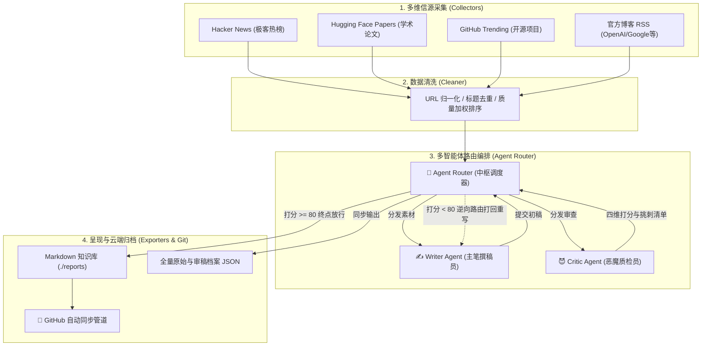

# 🪐 AI Daily Knowledge Agent (AI 每日情报知识管家)

> 每日全自动追踪全球 AI 前沿动态，经过多智能体路由协同、恶魔质检对抗打磨，沉淀为高质量结构化知识库。

[](https://github.com/cheeseooh-ctrl/AI-Knowledge-Agent)
[](https://www.python.org/)
[](LICENSE)

---

## 📌 版本演进与更新日志 (Changelog)

| 版本号 | 发布日期 | 架构类型 | 核心变更与新特性 |
| :---: | :---: | :---: | :--- |
| **`v1.1.0`** *(当前)* | 2026-11-14 | **多智能体动态路由架构** | 1. **引入 `AgentRouter` 调度中枢**：摆脱单一 Prompt，实现多智能体条件分发与反思回环。<br>2. **新增 `WriterAgent`**：负责第一版初稿撰写与基于反馈的二次重构。<br>3. **新增 `CriticAgent`**：设立“去公关化、实证度、落地性、辩证审视”四大苛刻维度量化打分（满分100，>=80放行）。<br>4. **支持 `--git-push`**：早报生成完毕后全自动提交并推送到 GitHub 知识库。<br>5. **新增设计文档**：归档 [`learning_notes/v1.1.0_Agent_Router_Design.md`](learning_notes/v1.1.0_Agent_Router_Design.md)。 |
| **`v1.0.0`** | 2026-11-14 | 确定性自动化流水线 | 1. 搭建四大信源采集矩阵（Hacker News、Hugging Face Papers、GitHub Trending、权威博客 RSS）。<br>2. 实现 URL 归一化剁尾巴、多维去重与质量打分排序。<br>3. 建立零依赖 Python 原生 REST 通信机制。<br>4. 实现自动排版并归档 Markdown/JSON 日报。 |

### 🚀 后续演进路线图 (Roadmap)
* [x] **v1.0.0**：零外部依赖的高可用数据采集与清洗流水线。
* [x] **v1.1.0**：Agent Router 驱动的“主笔 + 恶魔质检员”对抗博弈机制与 Git 自动同步。
* [ ] **v1.2.0**：引入「深度穿透研究员 (Deep Reader)」—— 当发现重磅突破时，自主调用工具翻阅论文全文与官方技术文档。
* [ ] **v1.3.0**：引入「个性化记忆中枢 (Memory)」—— 根据用户专属技术偏好进行千人千面的个性化过滤。
* [ ] **v2.0.0**：接入 GitHub Actions 云端全托管，实现电脑关机状态下的免开机定时推送（邮件/飞书/企微）。

---

## 🏛️ v1.1.0 核心系统架构图



---

## 📂 工作区完整目录结构清单 (已全面同步至 v1.1.0)

```
AI Knowledge Agent/
├── config.json                     # [v1.1.0] 全局配置文件 (信源规则、Router参数、Git推送开关)
├── .env.example                    # 环境变量配置模板 (GEMINI_API_KEY)
├── requirements.txt                # 可选依赖项 (requests, pyyaml, python-dotenv)
├── run.py                          # [v1.1.0] 一键执行入口 (支持 --mock, --git-push, --test-collect)
├── README.md                       # [v1.1.0] 本项目说明书与版本演进日志
├── learning_notes/                 # 📚 核心设计与知识沉淀专区
│   ├── AI_Agent_Architecture_QnA.md    # 智能体底层 12 个核心概念深度问答
│   └── v1.1.0_Agent_Router_Design.md   # [v1.1.0] Router 编排架构与时序交互图设计文档
├── src/
│   ├── utils.py                    # 零依赖 HTTP 通信、证书与环境读取水电工
│   ├── collectors/                 # 📡 4 大数据采集器
│   │   ├── base.py                 # NewsItem 标准数据盒子与 BaseCollector 抽象基类
│   │   ├── hackernews.py           # Hacker News Algolia 接口采集器
│   │   ├── huggingface.py          # Hugging Face Daily Papers 论文采集器
│   │   ├── github.py               # GitHub Trending 高星活跃开源项目采集器
│   │   └── rss.py                  # XML 原生解析 RSS/Atom 官方广播采集器
│   ├── processor/                  # 🧠 核心清洗与多智能体集群
│   │   ├── cleaner.py              # URL 追踪参数剥离、去重与质量打分排序
│   │   ├── router.py               # [v1.1.0] AgentRouter 中枢路由编排器
│   │   ├── writer_agent.py         # [v1.1.0] WriterAgent 主笔撰稿智能体
│   │   ├── critic_agent.py         # [v1.1.0] CriticAgent 恶魔质检评估智能体
│   │   ├── mock_summarizer.py      # 本地单机 Mock 替身模拟器
│   │   └── gemini_summarizer.py    # (v1.0.0 遗留兼容单次提炼器)
│   └── exporters/                  # 📰 导出与呈现
│       └── markdown_exporter.py    # [v1.1.0] Markdown 日报生成器 (内置虚拟编辑部质检档案徽章)
└── reports/                        # 历史情报日报归档目录
    ├── 2026-11-14_AI_Daily_Briefing.md
    └── 2026-11-14_AI_Daily_Briefing.json
```

---

## 🚀 快速上手使用

### 1. 配置 API Key（可选但推荐）
复制环境模板：
```bash
cp .env.example .env
```
在 `.env` 中填入你的 Gemini Key（在 [Google AI Studio](https://aistudio.google.com/app/apikey) 免费申请）：
```env
GEMINI_API_KEY=your_key_here
GEMINI_MODEL=gemini-2.5-flash
```

### 2. 执行运行指令

* **完整运行多智能体博弈（并自动同步推送至 GitHub）**：
  ```bash
  python3 run.py --git-push
  ```

* **本地单机模拟模式（无需 API Key，快速体验 Router 编排流转）**：
  ```bash
  python3 run.py --mock
  ```

* **仅测试底层网络采集（不调用智能体，查看抓回来的数据）**：
  ```bash
  python3 run.py --test-collect
  ```

---

## 🛡️ 恶魔质检员的四大审计铁律

每一篇通过 `AgentRouter` 发布的早报，都必须满足以下四大维度的严苛考核（满分 100 分，$\ge 80$ 分放行）：

1. **去公关化 (Anti-PR, 25%)**：剔除厂商洗脑宣传词，讲事实说人话。
2. **技术实证度 (Evidence Density, 25%)**：必须包含具体参数（7B/70B）、跑分（MMLU）或架构机制。
3. **落地启发性 (Actionability, 25%)**：明确对开发者与业务架构的具体实操意义。
4. **辩证审视度 (Critical Balance, 25%)**：科技皆有两面性，必须指出显存瓶颈、时延或闭源风险。
