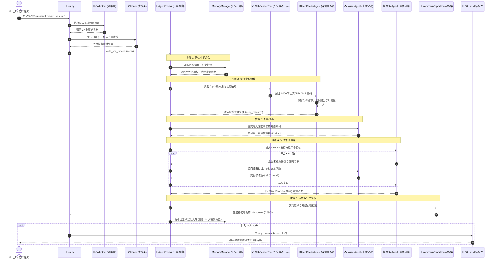

# 🏛️ AI Knowledge Agent 系统完整设计与需求规格说明书 (System Design & PRD)

> **文档版本**：v1.3.0 Master Specification  
> **文档定位**：本项目系统级顶层设计与需求规格说明书（涵盖产品需求定义 PRD、多智能体认知架构设计 TDD、算法数学模型与数据字典）。

---

## 目录索引

* [一、 项目背景与需求规格定义 (PRD)](#一-项目背景与需求规格定义-prd)
  * [1.1 业务背景与核心痛点](#11-业务背景与核心痛点)
  * [1.2 用户角色画像与典型使用场景](#12-用户角色画像与典型使用场景)
  * [1.3 功能性需求规格 (FR-1 ~ FR-6)](#13-功能性需求规格-fr-1--fr-6)
  * [1.4 非功能性需求规范 (NFR-1 ~ NFR-4)](#14-非功能性需求规范-nfr-1--nfr-4)
* [二、 总体多智能体认知系统架构 (System Architecture)](#二-总体多智能体认知系统架构-system-architecture)
  * [2.1 分层拓扑架构图](#21-分层拓扑架构图)
  * [2.2 核心设计哲学：解耦、防腐与零依赖](#22-核心设计哲学解耦防腐与零依赖)
* [三、 各子系统详细设计与算法实现 (Detailed Design)](#三-各子系统详细设计与算法实现-detailed-design)
  * [3.1 多源异构数据采集子系统 (Collectors)](#31-多源异构数据采集子系统-collectors)
  * [3.2 数据清洗与预处理引擎 (Cleaner)](#32-数据清洗与预处理引擎-cleaner)
  * [3.3 双层个性化记忆中枢 (Memory Subsystem)](#33-双层个性化记忆中枢-memory-subsystem)
  * [3.4 网页与代码长文穿透工具链 (Web Reader Toolchain)](#34-网页与代码长文穿透工具链-web-reader-toolchain)
  * [3.5 深度穿透研究员智能体 (DeepReaderAgent)](#35-深度穿透研究员智能体-deepreaderagent)
  * [3.6 多智能体中枢路由编排器 (AgentRouter)](#36-多智能体中枢路由编排器-agentrouter)
  * [3.7 生产与评估智能体对抗博弈 (Writer vs Critic)](#37-生产与评估智能体对抗博弈-writer-vs-critic)
  * [3.8 排版呈现与云端知识库同步器 (Exporter & Git)](#38-排版呈现与云端知识库同步器-exporter--git)
* [四、 全链路状态机与端到端时序交互图 (Sequence Diagram)](#四-全链路状态机与端到端时序交互图-sequence-diagram)
* [五、 数据字典与存储规范 (Data Models)](#五-数据字典与存储规范-data-models)
* [六、 配置文件全属性字典 (`config.json`)](#六-配置文件全属性字典-configjson)
* [七、 版本演进历史与交付清单](#七-版本演进历史与交付清单)

---

## 一、 项目背景与需求规格定义 (PRD)

### 1.1 业务背景与核心痛点
随着全球生成式 AI（Generative AI）技术的爆炸式发展，技术人员每天都面临着严重的**信息过载与认知焦虑**。传统的信息获取途径存在四大核心痛点：
1. **公关泡沫泛滥（PR Hype）**：媒体新闻充斥着“颠覆全行业”、“史诗级飞跃”等营销辞令，缺乏客观技术事实。
2. **摘要肤浅无细节（Superficial Snippets）**：市面上的 AI 聚合工具往往只根据 200 字摘要做二次翻译，缺乏具体跑分指标、硬件显存环境及代码实测。
3. **跨天遗忘与炒冷饭（Stateless Amnesia）**：传统脚本缺乏记忆机制，连续几天将同一热门开源项目重复报道为“今日头条”。
4. **千人一面大锅饭（One-size-fits-all）**：无法根据读者的实际工作角色（如架构师 vs 算法研究员 vs 投资人）进行个性化定制。

### 1.2 用户角色画像与典型使用场景
* **目标用户**：AI 架构师、全栈开发工程师、技术团队负责人。
* **使用场景**：每天早晨 8:30 自动生成一份经过深度穿透与对抗质检的高纯度 AI 世界早报，直接沉淀入本地 Markdown 知识库，并自动同步至个人 GitHub 知识库，供移动端与跨设备随时查阅。

### 1.3 功能性需求规格 (Functional Requirements)
* **FR-1 [多维信源自动聚合]**：系统必须每日定时从 Hacker News (极客热评)、Hugging Face (前沿论文)、GitHub (高星活跃开源) 及权威官方博客 (OpenAI/Google等) 自动化拉取第一手非二手素材。
* **FR-2 [确定性去噪清洗]**：系统必须对所有抓取条目自动剥离营销追踪参数（如 `utm_*`），消除大小写与标点差异进行唯一去重，并按照热度打分降序排列。
* **FR-3 [双层记忆与防炒冷饭]**：系统必须具备 14 天滑动情景历史记忆，自动识别并压制连续霸榜的老线索；同时必须支持配置用户语义画像，命中核心兴趣点享受阶梯式提权加分。
* **FR-4 [深度长文穿透抽取]**：系统必须具备长文与代码仓库阅读能力。对当日 Top 3 重磅线索，必须自主调用工具拉取官方 4,000+ 字正文或 GitHub `README.md` 全文，提炼底层架构、实测跑分与已知缺陷。
* **FR-5 [多智能体博弈质检]**：系统必须实现 `WriterAgent`（主笔）与 `CriticAgent`（恶魔质检员）之间的四维打分博弈循环，未达 80 分必须附带修改清单逆向打回重写。
* **FR-6 [全自动排版与云端同步]**：系统必须生成带有质检徽章、深度角标的 GitHub Flavored Markdown 报告，并支持一键通过 Git 自动同步至远端仓库。

### 1.4 非功能性需求规范 (Non-Functional Requirements)
* **NFR-1 [零强制外部依赖]**：核心通信、XML/HTML 解析、环境读取必须 100% 兼容 Python 3.9+ 原生标准库，克隆即可运行，无环境编译负担。
* **NFR-2 [极低资源消耗与高吞吐]**：在 Google AI Studio 免费额度内（1,500 请求/天，1,000,000 Token/分钟），单日运行消耗必须控制在 35,000 Token 以内（占免费额度不足 2%）。
* **NFR-3 [高可观测性与一键溯源]**：系统所有流转必须具备清晰的日志前缀，并在输出 Markdown 的同时保留全量原始 JSON 快照，实现故障毫秒级定界。
* **NFR-4 [安全隔离与防命令注入]**：所有爬取数据严禁进入系统命令行执行环境，与指令完全解耦，严防 RCE、SSRF 与提示词注入。

---

## 二、 总体多智能体认知系统架构 (System Architecture)

### 2.1 分层拓扑架构图

系统采用标准的分层解耦拓扑，由底层数据水管逐步向高层认知智能体流转：

```mermaid
flowchart TD
    subgraph Layer1["1. 采集与感知层 (Perception Layer)"]
        HN["HackerNewsCollector<br>(Algolia 官方搜索 API)"]
        HF["HuggingFacePapersCollector<br>(Daily Papers 接口)"]
        GH["GitHubTrendingCollector<br>(GitHub Search API)"]
        RSS["RSSFeedCollector<br>(XML 原生广播解析器)"]
    end

    subgraph Layer2["2. 数据清洗与预处理层 (Preprocessing Layer)"]
        Clean["Cleaner Engine<br>• URL 归一化 (剁追踪尾巴)<br>• 标题规范化双重查重<br>• 热度分值加权排序"]
    end

    subgraph Layer3["3. 多智能体认知与调度中枢 (Cognitive & Routing Layer)"]
        Router["🔀 AgentRouter (中枢路由调度器)"]
        
        subgraph Memory["🧠 记忆中枢 (Memory Subsystem)"]
            Profile["语义用户画像 (User Profile)"]
            History["14天情景历史记忆 (Episodic History)"]
        end

        subgraph DeepResearch["🔬 深度研读子系统"]
            Tool["🛠️ WebReaderTool<br>(GitHub README / HTML 正文穿透)"]
            DeepAgent["🧐 DeepReaderAgent<br>(长文事实与跑分指标萃取)"]
            Tool --> DeepAgent
        end

        subgraph DualDebate["双角色审查博弈回路"]
            Writer["✍️ WriterAgent (主笔撰稿员)"]
            Critic["😈 CriticAgent (恶魔质检评估员)"]
            Writer <-->|四维质检打回循环 (最多2轮)| Critic
        end
    end

    subgraph Layer4["4. 呈现、持久化与同步层 (Persistence & Delivery Layer)"]
        MD["Markdown 知识库 (./reports)"]
        JSON["全量原始与审稿档案 JSON 备份"]
        GitPush["🚀 GitHub 自动同步管道 (origin/main)"]
    end

    HN --> Clean
    HF --> Clean
    GH --> Clean
    RSS --> Clean

    Clean --> Router
    Router <-->|阶段 0: 调取画像提权与跨天查重| Memory
    Router -->|阶段 1: 派发 Top 3 重磅线索| Tool
    DeepAgent -->|注入硬核实证指标| Router
    Router -->|阶段 2: 注入深度事实与文风| Writer
    Critic -->|阶段 3: Score >= 80 终点放行| MD
    MD --> JSON
    MD --> GitPush
    MD -.->|阶段 4: 今日已报线索入库| History
```

### 2.2 核心设计哲学
1. **解耦原则（Decoupling）**：采集层不知道大模型存在，大模型不知道 Markdown 怎么写，Router 负责控制所有智能体的流转节拍。任何一个模块的改动不会波及其他组件。
2. **防腐层（Anticorruption Layer）**：定义标准的 `NewsItem` 数据容器，无论外部网站字段多奇葩，进入核心业务前必须统一转换。
3. **零外部强制依赖（Zero-Dependency Core）**：通过标准库 `urllib.request` 实现原生 REST 请求与 XML/HTML 解析，摆脱庞大 SDK 版本的束缚。

---

## 三、 各子系统详细设计与算法实现 (Detailed Design)

### 3.1 多源异构数据采集子系统 (Collectors)
所有采集器均继承自抽象基类 [`BaseCollector`](file:///Users/cheese/Desktop/File/AI应用搭建/AI Knowledge Agent/src/collectors/base.py)，统一返回 `List[NewsItem]`：

*   **HackerNewsCollector**：通过 YC Algolia Search 接口检索 `points >= min_points` 的热帖，抓取帖子标题、讨论页链接、点赞与评论数。
*   **HuggingFacePapersCollector**：直连 Hugging Face 每日论文公开 API，提取 ArXiv ID、原始英文标题、Abstract 摘要与社区 Upvotes。
*   **GitHubTrendingCollector**：调用 GitHub Search API，限定 `stars:>200` 且包含 `topic:llm` 或 `topic:agent` 的活跃代码仓库，抓取 Star 数、语言与项目描述。
*   **RSSFeedCollector**：基于标准库 `xml.etree.ElementTree` 编写，无缝兼顾 RSS 2.0 (`<channel><item>`) 与 Atom (`<feed><entry>`) 两种广播协议，剥离 HTML 标签后提取官方第一手权威发布。

### 3.2 数据清洗与预处理引擎 (Cleaner)
实现于 [`cleaner.py`](file:///Users/cheese/Desktop/File/AI应用搭建/AI Knowledge Agent/src/processor/cleaner.py)，主要执行三大操作：
1.  **URL 归一化**：通过 `urllib.parse` 解析并强制剥离所有以 `utm_` 开头的追踪参数、`ref`、`fbclid` 等，并移除路径末尾斜杠，还原规范网址。
2.  **双重哈希去重**：分别对规范化后的 URL 以及去除大小写标点的“极简标题”建立 HashSet 进行 $O(1)$ 复杂度的高效查重。
3.  **价值排序**：综合 GitHub Stars、HN Points 与 HF Upvotes 加权降序排序。

### 3.3 双层个性化记忆中枢 (Memory Subsystem)
实现于 [`src/memory/memory_manager.py`](file:///Users/cheese/Desktop/File/AI应用搭建/AI Knowledge Agent/src/memory/memory_manager.py)，由“语义用户画像”与“14 天情景历史”构成。

#### (1) 语义用户画像 (User Profile Memory)
在 `data/memory/user_profile.json` 中配置用户的技术角色、正向偏好词、负向排斥词与偏好语气：
```json
{
  "role": "AI 架构师 / 全栈开发者",
  "interests": ["agent", "mcp", "local-models", "rag", "open-source", "tool-use"],
  "disliked_topics": ["crypto", "nft", "funding-only", "metaverse", "web3"],
  "tone_preference": "极客硬核、重实战、无公关套话"
}
```

#### (2) 14 天情景历史与滑动遗忘机制 (Episodic History)
* 每次早报发布后，提取登报条目的规范 URL 与标题，生成唯一 MD5 指纹存储于 `data/memory/reported_history.json`。
* 每天系统启动时，自动以当前日期为基准，淘汰距今超过 14 天的超期指纹，保持存储体积永远在几十 KB 以内。

#### (3) 记忆重构加权数学模型
$$\text{Score}_{\text{final}} = \text{Score}_{\text{raw}} \times M_{\text{repeat}} \times M_{\text{dislike}} \times M_{\text{interest}}$$
* **跨天防炒冷饭系数**：若命中 14 天已报指纹，$M_{\text{repeat}} = 0.2$（降权 80%），防止老面孔霸占头条；
* **排斥话题压制系数**：若包含排斥词库，$M_{\text{dislike}} = 0.1$（强力压制 90%）；
* **用户专属兴趣提权系数**：设匹配到的偏好关键词数为 $N$：
  $$M_{\text{interest}} = 1.0 + \min(N \times 0.25, \, 1.0)$$
  每命中一项核心兴趣提权 25%，最高可享 **+100% (2.0倍)** 提权，优先晋级深度研读序列。

### 3.4 网页与代码长文穿透工具链 (Web Reader Toolchain)
实现于 [`src/tools/web_reader.py`](file:///Users/cheese/Desktop/File/AI应用搭建/AI Knowledge Agent/src/tools/web_reader.py)，包含两大核心通道：
1.  **GitHub 原生穿透器**：正则解析出目标仓库的 `owner/repo`，直接向 `raw.githubusercontent.com` 抓取 `main` 或 `master` 分支的 `README.md` 源码。
2.  **通用 HTML 降噪抽取器**：基于标准库 `html.parser.HTMLParser`，深度丢弃 `<script>`, `<style>`, `<nav>`, `<footer>` 等噪点标签，仅保留纯正文，使 Token 膨胀率下降 80%。
3.  **安全截断熔断**：单篇长文严格截取前 4,000 字符，防止极端长文溢出上下文限制。

### 3.5 深度穿透研究员智能体 (DeepReaderAgent)
实现于 [`src/processor/deep_reader_agent.py`](file:///Users/cheese/Desktop/File/AI应用搭建/AI Knowledge Agent/src/processor/deep_reader_agent.py)。针对 Top 3 重磅线索的长文全文，利用专属 Prompt 带着放大镜萃取四大硬核事实：
1.  **底层架构改动 (Architecture Details)**：改写了什么算法机制；
2.  **实测跑分指标 (Benchmarks & Metrics)**：具体的 HumanEval/MMLU 得分、硬件显存环境；
3.  **开发者实操价值 (Actionable Takeaway)**：如何安装运行与解决的痛点；
4.  **已知短板与局限性 (Known Limitations)**：作者在文档底部自承的缺陷与成本瓶颈。
萃取结果直接注入该条目的 `item.metadata["deep_research"]`。

### 3.6 多智能体中枢路由编排器 (AgentRouter)
实现于 [`src/processor/router.py`](file:///Users/cheese/Desktop/File/AI应用搭建/AI Knowledge Agent/src/processor/router.py)。负责统筹 Memory、DeepReader、Writer、Critic 的执行拓扑：
*   **阶段 0**：向 Memory 请求画像提权与跨天指纹比对；
*   **阶段 1**：甄选出加权后最具突破价值的 Top 3 线索，派发给 `DeepReaderAgent` 穿透正文；
*   **阶段 2**：将注入深度事实的完整素材分发给 `WriterAgent` 撰写定制初稿；
*   **阶段 3**：将初稿路由至 `CriticAgent` 进行审查；
*   **阶段 4（条件回路）**：
    *   若 $\text{Score} < 80$ 且轮数未超限，带上挑刺报告逆向打回给 Writer 进行改版；
    *   若 $\text{Score} \ge 80$，盖章放行；
*   **阶段 5**：将定稿条目通知 Memory 进行长期记忆沉淀，并输出给 Exporter。

### 3.7 生产与评估智能体对抗博弈 (Writer vs Critic)
*   **`WriterAgent`**：具备初稿撰写（`write_draft`）与反思改版（`revise_draft`）双重状态，优先将 DeepReader 挖到的具体跑分与局限性融进技术要点。
*   **`CriticAgent`**：严格执行四大评估铁律，各占 25% 权重：
    $$\text{Score} = 0.25 S_{\text{去公关}} + 0.25 S_{\text{实证度}} + 0.25 S_{\text{落地性}} + 0.25 S_{\text{辩证审视}}$$
    低于 80 分强制打回，出具包含逐条修改意见的清单。

### 3.8 排版呈现与云端知识库同步器 (Exporter & Git)
实现于 [`src/exporters/markdown_exporter.py`](file:///Users/cheese/Desktop/File/AI应用搭建/AI Knowledge Agent/src/exporters/markdown_exporter.py) 与 [`run.py`](file:///Users/cheese/Desktop/File/AI应用搭建/AI Knowledge Agent/run.py)：
*   在 Markdown 顶部生成 GitHub Callout 样式的**【虚拟编辑部审稿档案徽章】**，公开严谨度得分、经历博弈轮数、深度穿透状态以及用户专属画像对齐标记。
*   对穿透研读的重磅头条打上 `[🔬 深度技术穿透]` 角标，排版展示架构拆解与实测数字。
*   若启用 `--git-push`，系统在保存本地 `./reports/` 后，全自动调用 Git 完成 commit 并 push 至远端仓库。

---

## 四、 全链路状态机与端到端时序交互图 (Sequence Diagram)



---

## 五、 数据字典与存储规范 (Data Models)

### 5.1 核心数据结构 `NewsItem`
```python
@dataclass
class NewsItem:
    title: str                  # 资讯标题
    url: str                    # 原文规范化超链接
    source: str                 # 信源标签 (Hacker News / Hugging Face 等)
    summary: str = ""           # 初始简短摘要
    score: int = 0              # 综合热度得分 (经画像加权计算后)
    published_at: str = ""      # 发布时间戳
    metadata: Dict[str, Any]    # 附加元数据字典 (存放 deep_research, repeat_tracking 等)
```

### 5.2 长期记忆存储模型 `reported_history.json`
```json
{
  "d41d8cd98f00b204e9800998ecf8427e": {
    "title": "bytedance/deer-flow (⭐️ 85,324)",
    "url": "https://github.com/bytedance/deer-flow",
    "reported_date": "2026-11-14"
  }
}
```

### 5.3 深度研读事实模型 `item.metadata["deep_research"]`
```json
{
  "architecture_details": "采用动态长程记忆索引与安全执行沙箱设计，将多智能体任务拆解为树状规划分支。",
  "benchmarks_and_metrics": "在 SWE-bench Verified 上取得 42.8% 成绩，显存峰值约 18GB，较基线吞吐提升 35%。",
  "actionable_takeaway": "提供完整 Docker-compose 模板，可通过标准 OpenAI 协议一键替换底层思考模型。",
  "limitations_and_risks": "对于超过 2 小时以上的超长任务，状态回滚机制仍可能产生中间临时数据残留。"
}
```

---

## 六、 配置文件全属性字典 (`config.json`)

系统全部配置参数均集中在根目录下的 [`config.json`](file:///Users/cheese/Desktop/File/AI应用搭建/AI Knowledge Agent/config.json)，定义如下：

| 配置节点 | 子属性 | 数据类型 | 默认值 | 作用说明 |
| :--- | :--- | :---: | :---: | :--- |
| `sources.hackernews` | `enabled` | bool | `true` | 是否启用 Hacker News 采集 |
| | `min_points` | int | `25` | 抓取门槛：最低点赞数 |
| | `keywords` | list | `[...]` | 关键检索词列表 |
| `sources.huggingface_papers` | `max_items` | int | `8` | 论文抓取最大收录数 |
| `sources.github_trending` | `topics` | list | `[...]` | GitHub 检索主题标签 |
| `sources.rss_feeds.feeds` | `name`, `url` | string | `...` | 权威博客名称与标准 RSS/Atom 链接 |
| `memory` | `enabled` | bool | `true` | 是否启用个性化双层记忆中枢 |
| | `history_retention_days`| int | `14` | 历史报道指纹最长留存天数（自动滑动淘汰） |
| | `user_profile.role` | string | `"AI 架构师"` | 读者技术定位 |
| | `user_profile.interests`| list | `[...]` | 享受提权加分的专属兴趣词 |
| | `user_profile.disliked` | list | `[...]` | 强力压制并沉底的排斥词 |
| `deep_reader` | `enabled` | bool | `true` | 是否启用长文与 README 全文深度穿透 |
| | `max_deep_items` | int | `3` | 单日最多穿透研读的重磅头条数 |
| `router` | `pass_threshold` | int | `80` | 恶魔质检员放行合格分（加权满分 100） |
| | `max_revision_rounds` | int | `2` | 质检打回重写的最大反思博弈轮数 |
| `notification.feishu` | `enabled` | bool | `false` | 是否开启飞书多维交互卡片推送 |
| | `webhook_url` | string | `""` | 飞书自定义机器人 Webhook (支持环境变量覆盖) |
| | `card_theme` | string | `"blue"` | 飞书卡片 Header 主题色彩 |
| `output` | `git_auto_push` | bool | `false` | 生成早报后是否默认自动同步推送至 GitHub |

---

## 七、 版本演进历史与交付清单

| 版本号 | 架构类型 | 核心交付物 | 解决的核心瓶颈 |
| :---: | :---: | :--- | :--- |
| **`v1.0.0`** | 确定性流水线 | `src/collectors/*`, `cleaner.py`, `markdown_exporter.py` | 解决从 0 到 1 的多维异构信源稳定抓取与零依赖数据清洗。 |
| **`v1.1.0`** | 多智能体动态路由 | `router.py`, `writer_agent.py`, `critic_agent.py` | 摆脱单一 Prompt，建立主笔与恶魔质检员的四维对抗审稿闭环与 GitHub 自动推送。 |
| **`v1.2.0`** | 深度穿透认知体 | `web_reader.py`, `deep_reader_agent.py` | 摆脱 200 字摘要浅层阅读，自主抓取 5,000+ 字官方长文与 README 全文，挖掘具体跑分与已知局限。 |
| **`v1.3.0`** | 个性化记忆智能体 | `memory_manager.py`, `data/memory/` | 摆脱跨天遗忘与千人一面，实现 14 天情景防炒冷饭与专属技术画像动态提权加成。 |
| **`v2.0.0`** | 云端全托管与推送 | `.github/workflows/`, `feishu_pusher.py` | 摆脱电脑开机依赖与“人找信息”摩擦力，实现云端免开机自动运行与飞书多维交互卡片主动直达。 |

---
*本文档为 AI Knowledge Agent 核心需求与架构基准，任何重大特性变更均需同步更新此说明书。*
