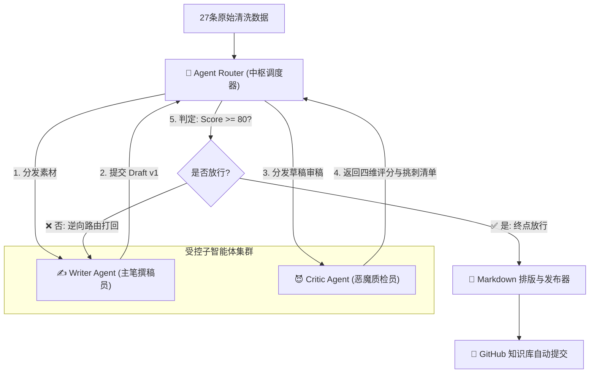
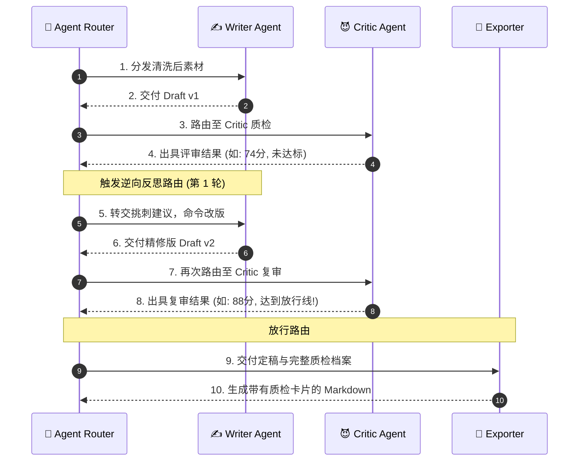

# 🔀 v1.1.0 架构设计文档：多智能体路由编排器 (Agent Router & Multi-Agent Architecture)

> **版本**：v1.1.0  
> **核心突破**：引入标准的 **Agent Router (任务路由调度器)**，实现 `Writer Agent` 与 `Critic Agent` 之间的条件流转、反思纠错与质量审查闭环。

---

## 目录

1. [为什么命名为 Router（路由编排器）？](#1-为什么命名为-router路由编排器)
2. [智能体系统架构与拓扑图](#2-智能体系统架构与拓扑图)
3. [两大子智能体职责定位 (Worker vs Critic)](#3-两大子智能体职责定位-worker-vs-critic)
4. [Critic Agent 四大审计铁律与量化模型](#4-critic-agent-四大审计铁律与量化模型)
5. [条件反馈路由状态机 (Conditional Feedback Routing)](#5-条件反馈路由状态机-conditional-feedback-routing)
6. [代码实现与核心文件清单](#6-代码实现与核心文件清单)
7. [GitHub 自动同步联动](#7-github-自动同步联动)

---

## 1. 为什么命名为 Router（路由编排器）？

在主流多智能体框架（如 LangGraph、Semantic Kernel、AutoGen）中，**“Router（路由器）”** 是最标准、最精准的系统角色定义：

* **它本身不产生内容**，也不是传统的固定脚本；
* 它的核心工作是**状态分发与分支判断（Dispatch & Condition Branching）**：
  * **正向路由**：把洗好的原材料分发给 `Writer Agent`；
  * **审查路由**：把草稿分发给 `Critic Agent`；
  * **条件反思路由**：质检不合格？带上错误日志**逆向路由打回**让 Writer 改写；
  * **终点路由**：质检合格？**放行路由**至 Markdown 排版器与 GitHub 同步器。

---

## 2. 智能体系统架构与拓扑图



---

## 3. 两大子智能体职责定位 (Worker vs Critic)

### 角色一：主笔撰稿员 (`WriterAgent`)
* **定位**：生产型 Worker Agent。
* **输入**：清洗后的 `NewsItem` 结构化素材。
* **两大核心方法**：
  * `write_draft(items)`：整合全网动态，产出第一版结构化草稿。
  * `revise_draft(draft, feedback)`：针对 Router 转交过来的 Critic 挑刺意见，定向修改、删去浮夸词、补充具体指标。

### 角色二：恶魔质检员 (`CriticAgent`)
* **定位**：评估与审计型 Evaluator Agent（魔鬼代言人）。
* **核心方法**：
  * `audit(draft)`：从不写稿，专门挑刺。对草稿进行四大维度百分制加权量化评估。

---

## 4. Critic Agent 四大审计铁律与量化模型

恶魔质检员从 4 个维度严格打分（各占 25% 权重）：

| 审计维度 | 权重 | 评估要点与扣分项 |
| :--- | :---: | :--- |
| **去公关化 (Anti-PR)** | **25%** | 严禁出现“史诗级”、“革命性”等空洞煽情词汇，必须中立客观叙述技术实质。 |
| **技术实证度 (Evidence Density)** | **25%** | 必须指出具体模型参数（7B/70B）、跑分评测基准得分、开源协议或架构机制。 |
| **落地启发性 (Actionability)** | **25%** | 必须回答：对真正的开发者、架构师或业务决策有何实操用处？能提效还是降本？ |
| **辩证审视度 (Critical Balance)** | **25%** | 科技永远有两面性。必须指出潜在瓶颈：显存门槛高、尚未开源、或时延问题。 |

**放行判定**：
$$\text{总分} \ge 80 \implies \text{passed: true，准予放行}$$

---

## 5. 条件反馈路由状态机 (Conditional Feedback Routing)

Router 内部通过标准状态机调度，控制最多 **2 轮反思循环**，在深度思考与 Token 成本之间取得完美平衡：



---

## 6. 代码实现与核心文件清单

*   [`src/processor/router.py`](file:///Users/cheese/Desktop/File/AI应用搭建/AI Knowledge Agent/src/processor/router.py)：核心调度路由类 `AgentRouter`。
*   [`src/processor/writer_agent.py`](file:///Users/cheese/Desktop/File/AI应用搭建/AI Knowledge Agent/src/processor/writer_agent.py)：主笔撰稿智能体。
*   [`src/processor/critic_agent.py`](file:///Users/cheese/Desktop/File/AI应用搭建/AI Knowledge Agent/src/processor/critic_agent.py)：恶魔质检评估智能体。
*   [`src/exporters/markdown_exporter.py`](file:///Users/cheese/Desktop/File/AI应用搭建/AI Knowledge Agent/src/exporters/markdown_exporter.py)：渲染包含“质检评分档案”的早报。
*   [`run.py`](file:///Users/cheese/Desktop/File/AI应用搭建/AI Knowledge Agent/run.py)：流水线入口，支持 `--git-push` 自动同步 GitHub。

---

## 7. GitHub 自动同步联动

使用以下命令运行：
```bash
python3 run.py --git-push
```
执行完毕后，系统不仅生成 Markdown 日报，还会自动调用 Git 将报告推送到你的 GitHub 仓库：  
👉 [https://github.com/cheeseooh-ctrl/AI-Knowledge-Agent](https://github.com/cheeseooh-ctrl/AI-Knowledge-Agent)
