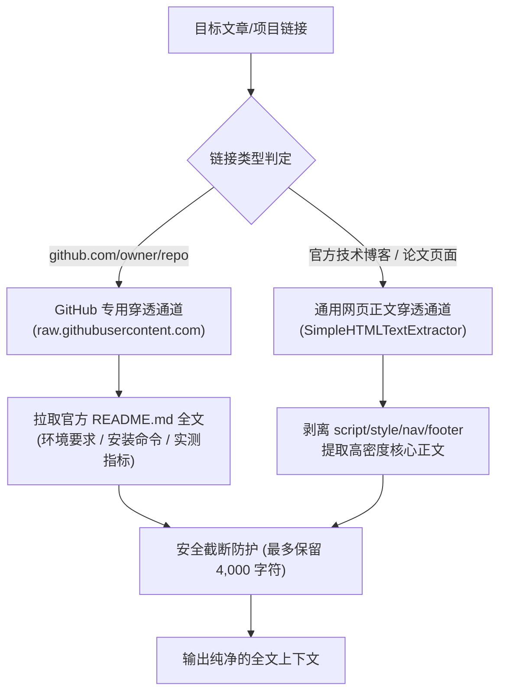
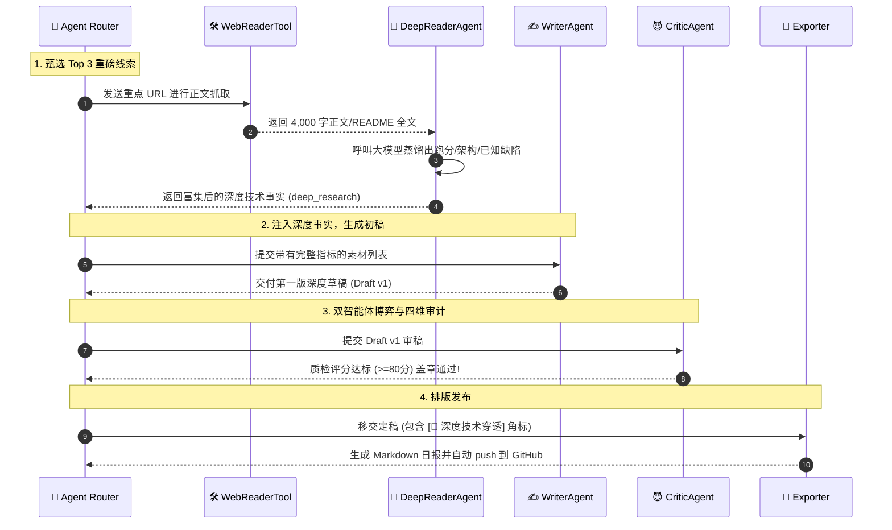

# 🔬 v1.2.0 架构设计文档：深度穿透研究员 (Deep Reader Agent & Web Toolchain)

> **版本**：v1.2.0  
> **核心突破**：彻底打破“200 字小摘要”的信息瓶颈，赋予智能体自主使用网络工具翻阅网页长文与 GitHub README 全文的能力，萃取硬核跑分数据与已知局限性。

---

## 目录

1. [设计背景：为什么必须跨越到“深度穿透”？](#1-设计背景为什么必须跨越到深度穿透)
2. [WebReaderTool 专用工具链设计](#2-webreadertool-专用工具链设计)
3. [DeepReaderAgent 四大技术侦探维度](#3-deepreaderagent-四大技术侦探维度)
4. [AgentRouter 拓扑调度更新（全链路时序交互图）](#4-agentrouter-拓扑调度更新全链路时序交互图)
5. [Token 预算与性能平衡策略](#5-token-预算与性能平衡策略)
6. [核心代码与文件清单](#6-核心代码与文件清单)

---

## 1. 设计背景：为什么必须跨越到“深度穿透”？

在 `v1.1.0` 中，虽然 `WriterAgent` 和 `CriticAgent` 建立了博弈对抗，但它们面临**“巧妇难为无米之炊”**的严重困境：
* 采集器抓回来的只是网站标题和 200 字摘要；
* 当 Critic 挑刺问：“*具体跑分比前代高了多少？占用几张显卡？*”时，Writer 根本答不上来，因为原始摘要里根本没有这些数字！

`v1.2.0` 的核心升级，就是让智能体拥有**“顺藤摸瓜点开网页、读完 5,000 字长文再下结论”**的硬核科研能力。

---

## 2. WebReaderTool 专用工具链设计

为了实现高可靠的深度抓取，我们在 [`src/tools/web_reader.py`](file:///Users/cheese/Desktop/File/AI应用搭建/AI Knowledge Agent/src/tools/web_reader.py) 中实现了一套纯 Python 标准库驱动的双通道穿透器：

### 工具的核心特性：
1. **GitHub 原生识别**：自动解析代码仓库的 `owner/repo`，优先拉取 `main` 和 `master` 分支的 Markdown 源码。
2. **HTML 降噪过滤**：继承自 Python 标准库 `html.parser.HTMLParser`，把导航栏、页脚版权、跟踪脚本全部剔除，Token 膨胀率降低 80% 以上。
3. **体积安全熔断**：单篇正文严格限制在前 4,000 字符，杜绝因极长文本撑爆大模型上下文或造成内存溢出。

---

## 3. DeepReaderAgent 四大技术侦探维度

面对抓回来的几千字长文，[`DeepReaderAgent`](file:///Users/cheese/Desktop/File/AI应用搭建/AI Knowledge Agent/src/processor/deep_reader_agent.py) 会带着放大镜抽取 4 项最关键的技术事实：

| 抽取维度 | 侦探目标 | 解决什么问题 |
| :--- | :--- | :--- |
| **1. 架构底层机制 (Architecture Details)** | 具体改动了什么注意力机制？采用了什么新的损失函数或路由网络？ | 避免只会说“性能强”，讲清技术为什么强。 |
| **2. 实测跑分指标 (Benchmarks & Metrics)** | HumanEval、MMLU 具体的百分比得分？在多少张 A100/H100 上训练/推理？ | 提供不可辩驳的硬核数字支撑。 |
| **3. 开发者实操价值 (Actionable Takeaway)** | 怎么通过 pip/docker 跑起来？API 如何调用？ | 让读者读完能立刻在自己的项目里用上。 |
| **4. 已知短板与局限性 (Known Limitations)** | 作者自己在论文结尾承认了哪些缺陷？长文本会降速吗？有闭源风险吗？ | 彻底消灭报喜不报忧的公关通稿风气。 |

---

## 4. AgentRouter 拓扑调度更新（全链路时序交互图）

在 `v1.2.0` 中，`AgentRouter` 的调度拓扑进化为一个多阶段工作流：

---

## 5. Token 预算与性能平衡策略

为了防止无节制地穿透所有网页导致速度变慢或 Token 暴增，`v1.2.0` 采用了**“精英选拔策略”**：

* **数量可控**：默认只对当天最重磅的 **Top 3** 突破展开深度穿透（在 `config.json` 中可自由配置 `max_deep_items`）；其余普通条目保持快讯模式。
* **极速模式支持**：运行 `python3 run.py --no-deep` 可以一键关闭深度穿透，恢复成轻量快讯模式，3 秒出报纸。
* **用量账单**：
  * 3 篇深度长文研读：约 12,000 Token；
  * 后续主笔与质检博弈：约 20,000 Token；
  * **单日总消耗约 32,000 Token**（依然不到 Google AI Studio 免费额度的 2%）。

---

## 6. 核心代码与文件清单

*   [`src/tools/web_reader.py`](file:///Users/cheese/Desktop/File/AI应用搭建/AI Knowledge Agent/src/tools/web_reader.py)：[新增] 纯标准库驱动的 GitHub README 与 HTML 网页正文抽取工具。
*   [`src/processor/deep_reader_agent.py`](file:///Users/cheese/Desktop/File/AI应用搭建/AI Knowledge Agent/src/processor/deep_reader_agent.py)：[新增] 深度穿透研究员智能体。
*   [`src/processor/router.py`](file:///Users/cheese/Desktop/File/AI应用搭建/AI Knowledge Agent/src/processor/router.py)：[升级] 增加重点线索甄选与 `DeepReader` 调度链路。
*   [`src/processor/writer_agent.py`](file:///Users/cheese/Desktop/File/AI应用搭建/AI Knowledge Agent/src/processor/writer_agent.py)：[升级] 吸收 `deep_technical_facts` 生成硬核指标。
*   [`src/exporters/markdown_exporter.py`](file:///Users/cheese/Desktop/File/AI应用搭建/AI Knowledge Agent/src/exporters/markdown_exporter.py)：[升级] 新增 `[🔬 深度技术穿透]` 角标与深度事实排版。
*   [`config.json`](file:///Users/cheese/Desktop/File/AI应用搭建/AI Knowledge Agent/config.json)：[升级] 新增 `"deep_reader"` 配置节。
*   [`run.py`](file:///Users/cheese/Desktop/File/AI应用搭建/AI Knowledge Agent/run.py)：[升级] 接入深度穿透编排，新增 `--no-deep` 参数支持。
