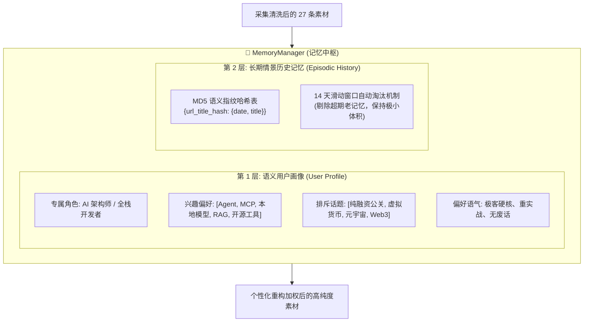
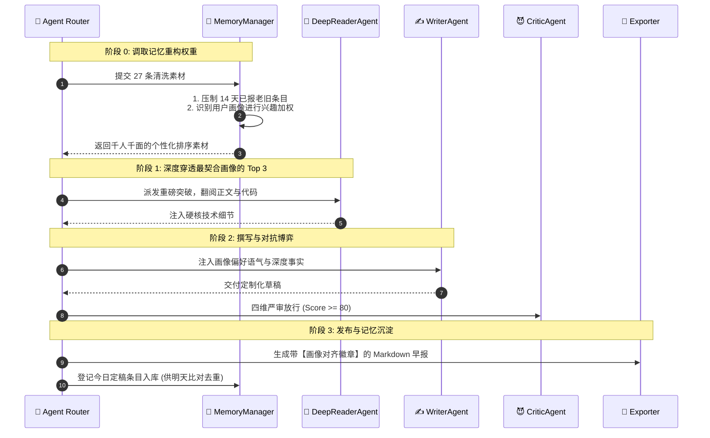

# 🧠 v1.3.0 架构设计文档：个性化记忆中枢 (Memory & Persona Subsystem)

> **版本**：v1.3.0  
> **核心突破**：彻底摆脱无状态（Stateless）的遗忘困境，建立由“14 天情景历史记忆”与“语义用户画像”驱动的双层记忆中枢，实现跨天防炒冷饭与千人千面的动态定制。

---

## 目录

1. [设计背景：无状态智能体的两大硬伤](#1-设计背景无状态智能体的两大硬伤)
2. [双层记忆架构设计 (Two-Tier Memory Model)](#2-双层记忆架构设计-two-tier-memory-model)
3. [个性化加权与防炒冷饭算法数学模型](#3-个性化加权与防炒冷饭算法数学模型)
4. [AgentRouter 记忆介入时序交互图](#4-agentrouter-记忆介入时序交互图)
5. [数据持久化与自动淘汰机制](#5-数据持久化与自动淘汰机制)
6. [核心代码与文件清单](#6-核心代码与文件清单)

---

## 1. 设计背景：无状态智能体的两大硬伤

在 `v1.2.0` 之前，我们的 Agent 是纯粹的**“无状态函数（Stateless）”**，这带来了两个严重的阅读体验缺陷：

1. **健忘症（跨天频繁炒冷饭）**：
   * 某些热门开源项目（如 Dify、Unsloth）或大模型（如 DeepSeek-R1）往往会在 GitHub Trending 或 Hacker News 连续霸榜 3~5 天。
   * 无状态的 Agent 每天早上一睁眼，就像失忆了一样，连续几天把同一件事作为“重磅头条”反复报道，极度浪费读者时间。
2. **大锅饭（千人一面，缺乏个性）**：
   * 算法工程师关心底层 CUDA 优化与量化算子；
   * 全栈应用开发者关心 Agent 编排、MCP 协议与 RAG 落地；
   * 投资人关心融资金额与商业化估值。
   * 如果没有用户画像记忆，Agent 输出的内容永远是折中的中间态，无法针对你的核心痛点量身定制。

---

## 2. 双层记忆架构设计 (Two-Tier Memory Model)

我们在 [`src/memory/memory_manager.py`](file:///Users/cheese/Desktop/File/AI应用搭建/AI Knowledge Agent/src/memory/memory_manager.py) 中构建了兼顾**历史时效**与**主观偏好**的双层记忆中枢：

---

## 3. 个性化加权与防炒冷饭算法数学模型

每条输入的新闻动态，都会在记忆中枢内接受三重打分重构：

$$\text{Score}_{\text{final}} = \text{Score}_{\text{raw}} \times M_{\text{repeat}} \times M_{\text{dislike}} \times M_{\text{interest}}$$

### (1) 跨天去重惩罚系数 $M_{\text{repeat}}$
* 若该条目的 MD5 指纹命中过去 14 天的已报道记录：
  $$M_{\text{repeat}} = 0.2 \quad (\text{大幅降权 80\%，并打上 repeat\_tracking 标签})$$
* 确保上过榜的老面孔退居二线，给真正的新生突破让路。

### (2) 厌恶话题惩罚系数 $M_{\text{dislike}}$
* 若内容匹配到用户排斥词库（如 crypto、funding-only、nft）：
  $$M_{\text{dislike}} = 0.1 \quad (\text{强力压制 90\%，直接沉底})$$

### (3) 用户专属兴趣加成系数 $M_{\text{interest}}$
* 设匹配到的兴趣关键词（agent, mcp, rag, local-models）数量为 $N$：
  $$M_{\text{interest}} = 1.0 + \min(N \times 0.25, \, 1.0)$$
* 每命中一个核心兴趣点加成 25%，最高可获得 **+100%（即 2.0 倍）** 的权重提权，直接保送进入 Top 3 深度穿透序列！

---

## 4. AgentRouter 记忆介入时序交互图

在 `v1.3.0` 中，记忆中枢在流程的**“最前端（打分重构）”**与**“最末端（记忆沉淀）”**形成首尾闭环：

---

## 5. 数据持久化与自动淘汰机制

记忆数据完全保存在本地磁盘：
* **用户偏好配置**：`data/memory/user_profile.json`（可随时用文本编辑器手动修改兴趣词）。
* **历史报道记录**：`data/memory/reported_history.json`。
* **自动遗忘机制**：系统每天启动时，自动计算 `cutoff_date = 今天 - 14天`，将 14 天以前的老记忆安全清除，保证历史文件始终只有几十 KB，绝不膨胀。
* **重置命令**：用户随时可以在终端输入 `python3 run.py --clear-memory` 一键格式化历史记忆库，轻松归零重新开始。

---

## 6. 核心代码与文件清单

*   [`src/memory/memory_manager.py`](file:///Users/cheese/Desktop/File/AI应用搭建/AI Knowledge Agent/src/memory/memory_manager.py)：[新增] 双层记忆中枢管理器。
*   [`src/processor/router.py`](file:///Users/cheese/Desktop/File/AI应用搭建/AI Knowledge Agent/src/processor/router.py)：[升级] 首尾闭环接入记忆调取与记忆沉淀。
*   [`src/exporters/markdown_exporter.py`](file:///Users/cheese/Desktop/File/AI应用搭建/AI Knowledge Agent/src/exporters/markdown_exporter.py)：[升级] 早报顶部新增 `🧠 画像对齐` 与 `🔄 跨天防炒冷饭` 状态徽章。
*   [`config.json`](file:///Users/cheese/Desktop/File/AI应用搭建/AI Knowledge Agent/config.json)：[升级] 新增 `"memory"` 配置节（可配置角色、兴趣词、厌恶词与留存天数）。
*   [`run.py`](file:///Users/cheese/Desktop/File/AI应用搭建/AI Knowledge Agent/run.py)：[升级] 支持 `--no-memory` 与 `--clear-memory` 参数。
