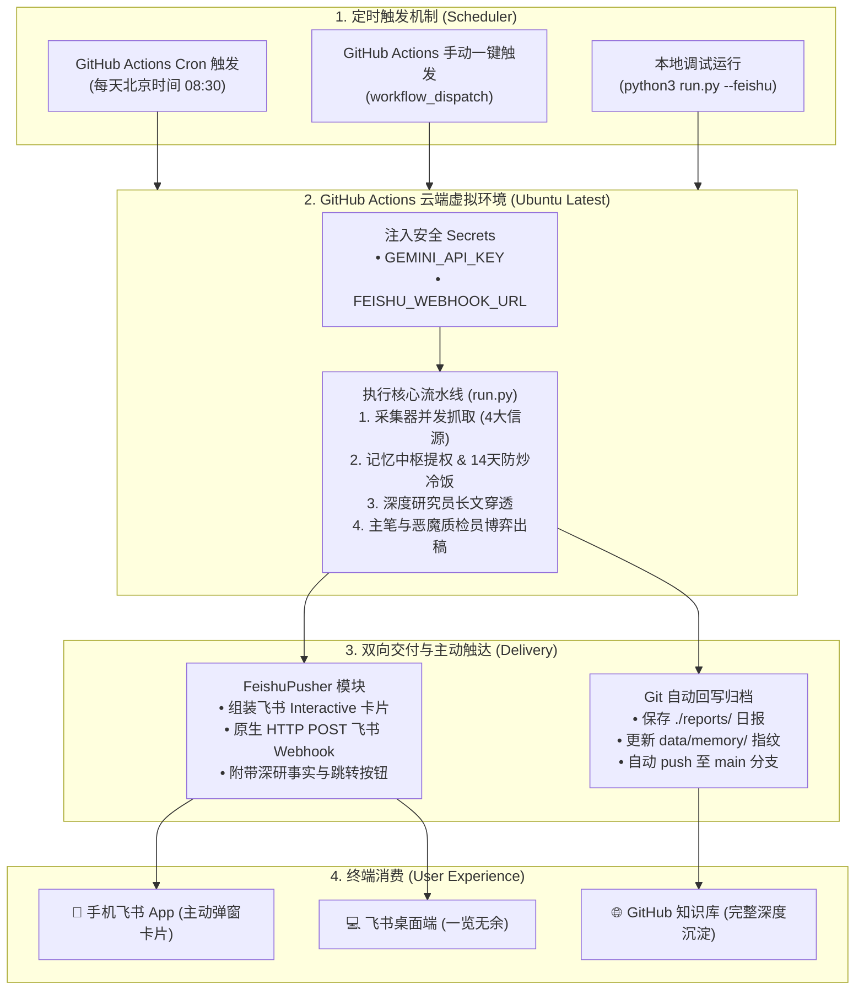

# 🚀 v2.0.0 云端全托管与飞书多维卡片推送架构设计 (Cloud Automation & Feishu Notification Design)

> **版本**：v2.0.0  
> **状态**：已就绪 / 实施中  
> **核心目标**：从“本地手动命令执行”跃迁为“7×24 云端免开机全托管 + 飞书高颜值交互卡片主动触达”。

---

## 目录索引

* [一、 需求背景与设计动机](#一-需求背景与设计动机)
* [二、 系统架构拓扑图 (v2.0.0)](#二-系统架构拓扑图-v200)
* [三、 飞书交互式卡片 (Interactive Card) 协议设计](#三-飞书交互式卡片-interactive-card-协议设计)
* [四、 GitHub Actions 云端免开机调度管道设计](#四-github-actions-云端免开机调度管道设计)
* [五、 配置项定义与密钥安全治理](#五-配置项定义与密钥安全治理)
* [六、 异常防御与优雅降级机制](#六-异常防御与优雅降级机制)

---

## 一、 需求背景与设计动机

在 `v1.3.0` 之前，系统已经具备了强大的信息摄入、长文深度穿透、个性化记忆与对抗审稿能力。然而在真实日常使用中，仍存在两大“摩擦力”：
1. **强依赖本地电脑开机状态**：必须每天在 Mac 终端中手动运行 `python3 run.py --git-push`，一旦出差、休假或电脑关机睡眠，自动化早报便会中断；
2. **“人找信息”体验不佳**：即便每日成功同步至 GitHub，用户仍需要主动打开浏览器访问仓库页面查阅，无法做到“早上睁眼，情报已送达手机”。

**v2.0.0 核心使命**：
* 引入 **GitHub Actions** 作为云端零成本调度引擎，设定每日晨间定时无感执行；
* 引入 **飞书自定义机器人 Webhook (Feishu Interactive Card)**，以高颜值的排版卡片将【质检档案】、【深度技术穿透】和【精编资讯】直接推送到手机/桌面端飞书。

---

## 二、 系统架构拓扑图 (v2.0.0)



---

## 三、 飞书交互式卡片 (Interactive Card) 协议设计

为了呈现极致的阅读体验，抛弃枯燥的纯文本格式，全面采用飞书标准 **`interactive` 卡片协议**：

### 3.1 卡片结构拆解
1. **卡片 Header**：主题蓝色（`blue`）高亮标题，标明日期与总览；
2. **审稿档案徽章区**：
   * 恶魔质检严谨度得分（如 `88/100`）；
   * 博弈轮数（如 `1 轮放行`）；
   * 专属画像对齐标记（如 `已匹配专属兴趣提权`）；
3. **深度穿透头条区 (`[🔬 深度技术穿透]`)**：
   * 展示 Top 3 重磅线索的原文链接；
   * 提炼底层架构变化、实测跑分指标及已知局限性；
4. **精选资讯脉冲区**：
   * 呈现前沿论文、开源项目与极客讨论；
5. **快捷跳转按钮 (Action)**：
   * 点击直达 GitHub 远端完整版 Markdown 报告。

### 3.2 报文协议示例
```json
{
  "msg_type": "interactive",
  "card": {
    "config": {
      "wide_screen_mode": true
    },
    "header": {
      "title": {
        "tag": "plain_text",
        "content": "🪐 AI Daily Briefing | 2026-11-16 每日情报内参"
      },
      "template": "blue"
    },
    "elements": [
      {
        "tag": "div",
        "text": {
          "tag": "lark_md",
          "content": "**【虚拟编辑部审稿档案】**\n🎯 严谨度评分：**88/100** | 🔄 博弈轮数：1轮 | 🧠 画像对齐：已激活动态提权"
        }
      },
      {
        "tag": "hr"
      },
      {
        "tag": "div",
        "text": {
          "tag": "lark_md",
          "content": "### 🔬 深度技术穿透 (Top 3 重磅)\n1. **[deer-flow (ByteDance)](https://github.com/bytedance/deer-flow)**\n> • **架构细节**: 动态长程记忆索引与沙箱隔离设计。\n> • **实测指标**: SWE-bench 取得 42.8% 突破，峰值显存 18GB。"
        }
      },
      {
        "tag": "action",
        "actions": [
          {
            "tag": "button",
            "text": {
              "tag": "plain_text",
              "content": "📖 在 GitHub 查阅完整今日知识库"
            },
            "type": "primary",
            "url": "https://github.com/cheeseooh-ctrl/AI-Knowledge-Agent/blob/main/reports/latest.md"
          }
        ]
      }
    ]
  }
}
```

---

## 四、 GitHub Actions 云端免开机调度管道设计

在 `.github/workflows/daily_briefing.yml` 中编排全自动化流转：

### 4.1 触发器配置
* **定时 Cron**：`cron: '30 0 * * *'`（UTC 时间 00:30，即北京时间早晨 08:30）；
* **手动按需触发**：`workflow_dispatch`（支持在 GitHub 仓库操作页面一键点击测试）。

### 4.2 流水线核心步骤
1. **拉取源码与历史记忆**：检出完整分支历史；
2. **初始化 Python 3.10 原生环境**：零编译零重型包，直接启动；
3. **注入安全密钥**：从 GitHub Secrets 中安全映射 `GEMINI_API_KEY` 与 `FEISHU_WEBHOOK_URL`；
4. **运行多智能体全链路**：
   ```bash
   python3 run.py --feishu
   ```
5. **记忆库与报告自动回写 (Git Auto-Commit)**：
   * 将新生成的 `./reports/*.md`、`./reports/*.json` 以及更新后的 `data/memory/reported_history.json` 自动 commit 回 `main` 分支；
   * 提交信息附加 `[skip ci]` 标签，防止触发递归死循环构建。

---

## 五、 配置项定义与密钥安全治理

### 5.1 `config.json` 新增节点
```json
{
  "notification": {
    "feishu": {
      "enabled": false,
      "webhook_url": "",
      "card_theme": "blue"
    }
  }
}
```

### 5.2 密钥安全优先级原则
1. **环境变量最高优先**：代码中优先读取 `os.environ.get("FEISHU_WEBHOOK_URL")`；
2. **配置文件备用**：若环境变量未配置，则尝试读取 `config.json` 中的 `webhook_url`；
3. **绝不硬编码**：禁止将真实的 Webhook URL 提交入 Git 仓库，模板以空字符串提供。

---

## 六、 异常防御与优雅降级机制

1. **推送失败不阻塞流水线**：若飞书接口出现网络抖动（如 500/超时）或 Webhook 失效，系统仅记录 ERROR 日志，绝不中断本地报告生成和 Git 归档；
2. **长文超限自动截断**：飞书交互卡片单块文字有最大字符限制（一般为 4,000 字符），`FeishuPusher` 会自动对摘要做动态修剪，确保卡片永远不因 Payload 超大被飞书网关拒收；
3. **Dry-Run 模拟机制**：支持通过 `--dry-run-feishu` 查看组装好的飞书卡片 JSON 结构，方便无 Webhook 环境下的离线排查。
