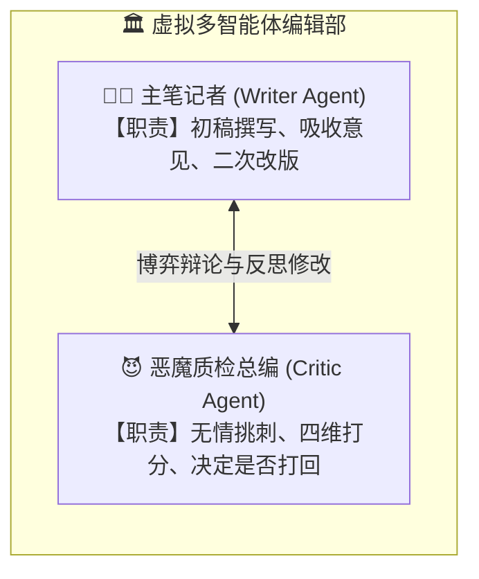
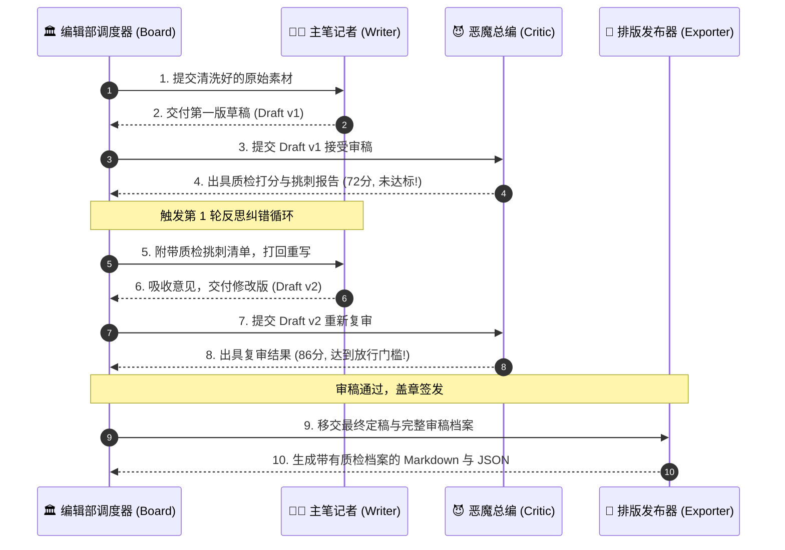

# 🏛️ v1.1.0 架构设计文档：虚拟多智能体编辑部（主笔与恶魔质检员对抗博弈体系）

> **版本**：v1.1.0  
> **核心突破**：彻底摆脱单一 Prompt 的线性脚本模式，构建真正的多智能体双角色辩论、反思与审稿打磨闭环。

---

## 目录

1. [设计背景：为什么需要虚拟编辑部？](#1-设计背景为什么需要虚拟编辑部)
2. [两大智能体角色设定与职责划分](#2-两大智能体角色设定与职责划分)
3. [恶魔质检员的四大审计铁律与打分模型](#3-恶魔质检员的四大审计铁律与打分模型)
4. [多轮博弈循环状态机（时序交互图）](#4-多轮博弈循环状态机时序交互图)
5. [核心代码模块职责与拓扑结构](#5-核心代码模块职责与拓扑结构)
6. [成果呈现：Markdown 报告中的“审稿档案”设计](#6-成果呈现markdown-报告中的审稿档案设计)
7. [GitHub 云端知识库自动联动机制](#7-github-云端知识库自动联动机制)

---

## 1. 设计背景：为什么需要虚拟编辑部？

在 `v1.0.0` 基础版本中，系统采用的是典型的**单次直出（Single-Pass Prompting）**机制：
`原始数据 -> 规则清洗 -> 呼叫一次 Gemini -> 直接输出报告`。

这种常规做法有三个难以克服的天然缺陷：
1. **容易被公关通稿洗脑**：厂商发布会常常吹嘘“颠覆行业”、“史诗级革命”，大模型在单次总结时容易顺着原文复述浮夸辞令。
2. **缺乏技术深度与实证数据**：常常只写“性能显著提升”，却不说明具体跑分基准、参数规模或架构创新点。
3. **报喜不报忧**：很少主动探讨这项技术的潜在缺陷、显存门槛、闭源风险或推理成本。

为了彻底解决上述痛点，`v1.1.0` 引入了**虚拟多智能体编辑部（Multi-Agent Editorial Board）**，让两个性格迥异的智能体在后台相互博弈与对抗，直到打磨出兼具客观性、深度与实操价值的高分报告。

---

## 2. 两大智能体角色设定与职责划分



### 角色一：主笔撰稿记者 (`WriterAgent`)
* **定位**：资深科技媒体主笔。
* **性格特点**：对前沿技术保持敏锐触觉，擅长将复杂的学术论文与代码仓库转化为通俗易懂的专业中文。
* **双重能力**：
  * **撰写初稿 (`write_draft`)**：通读清洗后的海量原始数据，写出结构化的第一版草稿。
  * **反思重写 (`revise_draft`)**：当收到质检员打回的挑刺清单时，主动删除浮夸辞令，补充具体的参数指标与局限性思考。

### 角色二：恶魔质检总编 (`CriticAgent`)
* **定位**：苛刻、挑剔、追求极致严谨的“魔鬼代言人（Devil's Advocate）”。
* **座右铭**：*“绝不让任何一篇带有公关通稿味道的空洞内容糊弄读者。”*
* **工作方式**：从不写稿，只拿放大镜审稿。对每一篇草稿进行四大维度量化打分，只有达到合格线（默认 80 分）才允许放行签发，否则强制打回。

---

## 3. 恶魔质检员的四大审计铁律与打分模型

恶魔质检员采用**百分制加权评估模型**，四项指标各占 25% 权重：

| 审计维度 | 权重 | 审核标准与扣分红线 | 预期改进效果 |
| :--- | :---: | :--- | :--- |
| **1. 去公关化 (Anti-PR)** | **25%** | 严禁出现“史诗级”、“革命性”、“前所未有”等空洞煽情词汇。必须用中立客观的技术语言叙述。 | 剔除厂商营销泡沫，还原技术本来面目。 |
| **2. 技术实证度 (Evidence Density)** | **25%** | 必须指出具体模型参数（如 7B/70B）、跑分评测基准（MMLU/HumanEval 得分）、开源协议或底层机制。泛泛而谈者重扣！ | 确保每条资讯都有硬核技术依据。 |
| **3. 落地启发性 (Actionability)** | **25%** | 必须回答：这项突破对真实世界中的开发者、架构师或业务决策到底有什么具体用处？能省钱？能提效？还是架构解耦？ | 避免纯理论空谈，赋予文章实操指导价值。 |
| **4. 辩证审视度 (Critical Balance)** | **25%** | 任何技术都有局限。必须主动指出潜在缺点：如显存门槛过高、代码暂未开源、存在严重幻觉或长上下文时延等。 | 帮助读者避坑，保持冷静理智。 |

**放行公式**：
$$\text{总分} = 0.25 \times S_{\text{去公关}} + 0.25 \times S_{\text{实证度}} + 0.25 \times S_{\text{落地性}} + 0.25 \times S_{\text{辩证审视}}$$
* 若 $\text{总分} \ge 80$，盖章放行（`passed: true`）；
* 若 $\text{总分} < 80$，附带针对性的逐条修改清单，打回主笔重写（`passed: false`）。

---

## 4. 多轮博弈循环状态机（时序交互图）

虚拟编辑部内部的协作是一个严密的**有限状态机（Finite State Machine）**，支持最多 2 轮反思纠错循环，兼顾了深度思考与响应效率：



---

## 5. 核心代码模块职责与拓扑结构

本次 `v1.1.0` 升级新增并重构了以下核心模块：

```
AI Knowledge Agent/
├── src/processor/
│   ├── writer_agent.py          # [新增] 主笔撰稿记者：实现 draft 与 revise 两大核心动作
│   ├── critic_agent.py          # [新增] 恶魔质检总编：实现四维量化打分与挑刺清单生成
│   ├── editorial_board.py       # [新增] 虚拟编辑部协调器：实现状态机调度与循环博弈
│   ├── cleaner.py               # 数据清洗与去重
│   └── mock_summarizer.py       # 离线单机模拟器
├── src/exporters/
│   └── markdown_exporter.py     # [升级] 新增“虚拟编辑部审稿档案与总编评语”渲染卡片
├── config.json                  # [升级] 新增 editorial_board 配置节（门槛分、最大轮数）
└── run.py                       # [升级] 接入编辑部总调度，新增 --git-push 自动云端同步
```

---

## 6. 成果呈现：Markdown 报告中的“审稿档案”设计

每一份最终生成的 Markdown 日报顶部，现在都会嵌入一份**透明、可追溯的审稿档案徽章**：

> [!TIP]
> 🛡️ **虚拟编辑部审稿档案**：综合严谨度评分 **`88 / 100`** ｜ 经历 **`2 轮`** 主笔与恶魔质检员博弈打磨
> * 去公关化: `90分` ｜ 技术实证度: `85分` ｜ 落地启发性: `88分` ｜ 辩证审视: `88分`
> * 总编评语: *"已剔除厂商过度夸大的修饰词，补充了模型在长推理场景下的显存瓶颈说明，达到签发标准。"*

**这一设计的价值**：
让读者一眼看出这篇早报不是粗制滥造的单次翻译，而是经过内部对抗审查、事实核查与去水处理的高纯度情报。

---

## 7. GitHub 云端知识库自动联动机制

为了实现你在上一轮提出的“自动化版本归档”，`v1.1.0` 在 `run.py` 尾部增加了全自动 Git 同步管道：

* 运行命令时加上 `--git-push` 参数：
  ```bash
  python3 run.py --git-push
  ```
* **自动化行为**：
  1. 采集并完成多智能体博弈；
  2. 生成当天的 Markdown 与 JSON 报告；
  3. 自动执行 `git add reports/`；
  4. 自动执行 `git commit -m "docs: 自动同步 YYYY-MM-DD AI 每日情报早报 [v1.1.0]"`；
  5. 自动 `git push origin main` 到你的 GitHub 仓库。

你只要在手机或电脑打开 [GitHub 仓库](https://github.com/cheeseooh-ctrl/AI-Knowledge-Agent)，即可看到带着最新审稿档案的沉淀知识！
